# Лабораторная работа №4

**Тема:** Анализ набора данных с помощью SQL  
**Предметная область примера:** сервис аренды велосипедов  
**СУБД:**  SandboxSQL
**Файл базы:** `dataset.sqlite

## Шаг 1. Загрузка базы и первичная проверка

В SandboxSQL загружена SQLite-база. Выполнена проверка числа строк во всех шести таблицах.

**Количество записей.** `

```sql
SELECT COUNT(*) AS total_students FROM students;SELECT COUNT(*) AS total_courses FROM courses;SELECT COUNT(*) AS total_enrollments FROM enrollments;SELECT COUNT(*) AS total_groups FROM groups;SELECT COUNT(*) AS total_teachers FROM teachers;SELECT COUNT(*) AS total_results FROM results;
```

**Результат:**

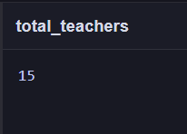
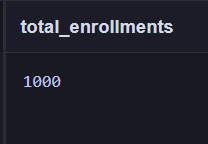
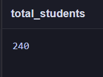
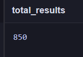
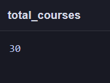
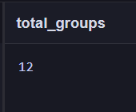

## Шаг 2. Изучение структуры и формулирование аналитических вопросов

| Таблица | Назначение | Основные поля | Записей |
|---|---|---|---:|
| `groups` | Группы | `id`, `name`, `stude_year` | 12 |
| `students` | Студенты | `id`, `group_id`, `admission year` | 240 |
| `teachers` | Преподаватели | `id`, `full_name`, `department` | 15 |
| `courses` | Курсы | `id`, `name`, `hours`, `tecaher_id` | 30 |
| `enrollments` | Поступления | `id`, `student_id`, `course_id`, `enrolled_at`, `status` | 1000 |
| `results` | Результаты | `id`, `enrollment_id`, `score`, `completed_at` | 850 |

**Связи:**
- students и groups
- courses и teachers
- enrollments и students, courses
- results и enrollments

  **Просмотр данных.** Просмотр первых пяти студентов.

```sql
SELECT * FROM students LIMIT 5;
```

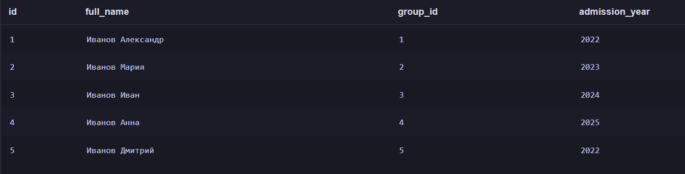

  **Просмотр данных.** Просмотр первых пяти записей.
 
```sql
SELECT * FROM enrollments LIMIT 5;
```

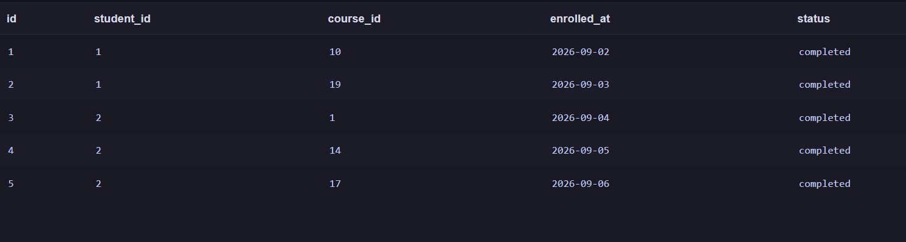

**Первичные и внешние ключи. Связи между таблицами**

В базе данных используются первичные ключи (`PRIMARY KEY`) для идентификации записей и внешние ключи (`FOREIGN KEY`) для связи таблиц.

- `groups.id` — первичный ключ группы.
- `students.id` — первичный ключ студентов.
- `teachers.id` — первичный ключ преподователей.
- `courses.id` — первичный ключ курса.
- `enrollments.id` — первичный ключ поступления.
- `results.id` — первичный ключ результатов.

**Связи между таблицами:**

enrollments связана с students и courses. Конкретный студент поступил на конкретный курс.

students связана с groups. Каждый студент находится в определенной группе.

**Сформулированные аналитические вопросы:**

1. Какие студенты ни разу не записывались на курсы? Сколько их и к каким группам они относятся?(`students`, `groups`, `enrollments`)
2. Сколько студентов в каждой группе?(`students`, `groups`)
3. Сколько студентов записалось на самое большое количество курсов?( `enrollments`)
4. На какой курс больше всего записей?(`courses`, `enrollments`)
5. На каком курсе больше всего результатов "100"?(`courses`, `enrollments`, `results`)
6. Какие студенты учаться в конкретной группе?(`students`)
7. В каких группах учится более 15 студентов?(`students`)
## Шаг 3. Фильтрация и сортировка

### 2 Вопрос

```sql
SELECT group_id, COUNT(id) FROM students GROUP BY group_id
```
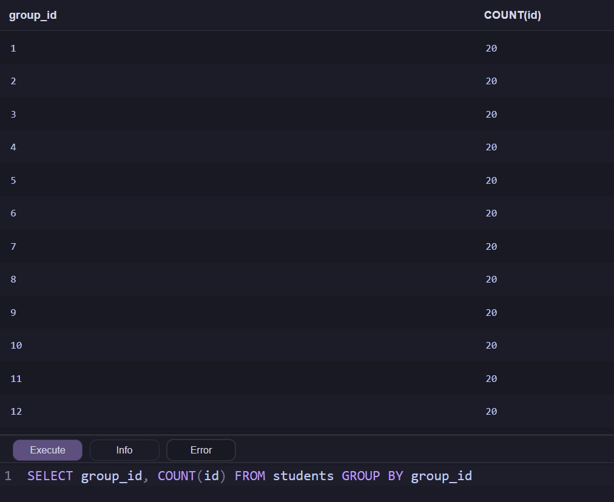

Связь students и groups. Смотрим сколько студентов в каждой группе.

### 6 Вопрос

```sql
SELECT full_name , group_id FROM students WHERE group_id=1
```
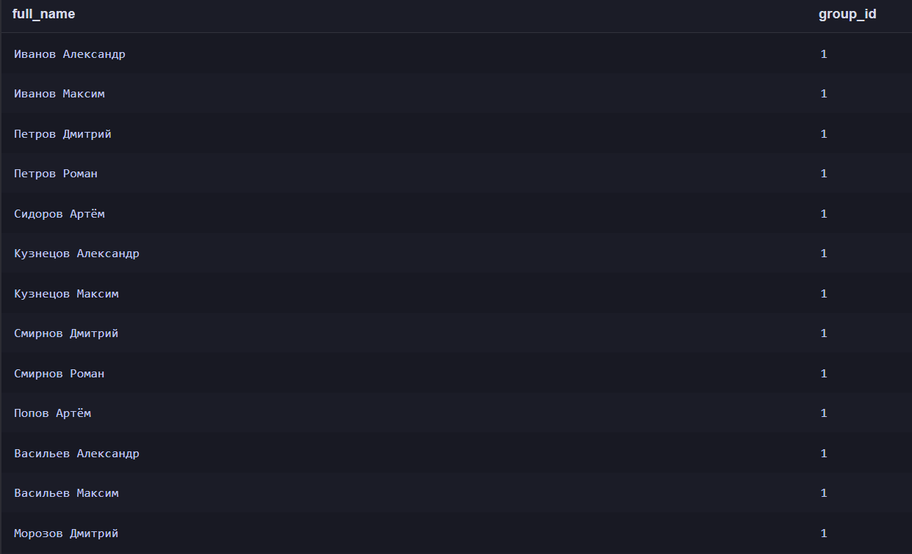

Связь students и group. Через group_id считаем студентов с одинаковым значением.

## Шаг 4. Агрегирование и группировка


Связь students и groups. Смотрим сколько студентов в каждой группе.

### 3 Вопрос

```sql
SELECT student_id, COUNT(course_id) AS course_count FROM enrollments GROUP BY student_id ORDER BY course_count DESC;
```
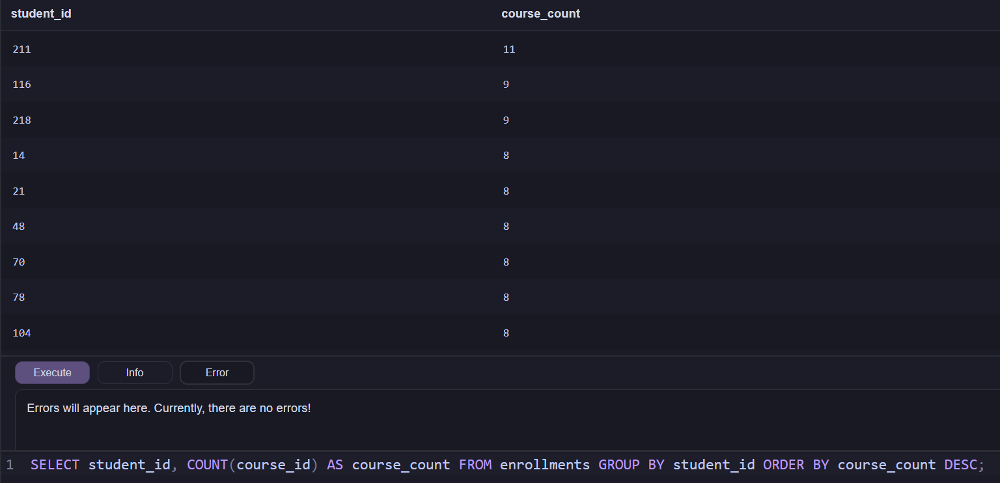

### 4 Вопрос

```sql
SELECT course_id, COUNT(student_id) AS student_count FROM enrollments GROUP BY course_id ORDER BY student_count DESC;
```
Связь students и courses через enrollments. Через поступления смотрим сколько студентов имеет одниковое id курсы.

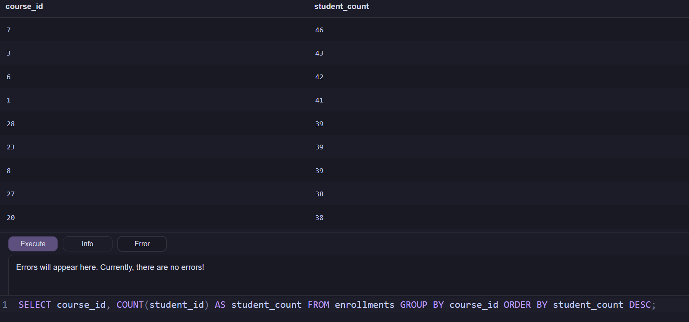

### 7 Вопрос

```sql
SELECT group_id, COUNT(id) AS student_count FROM students GROUP BY group_id HAVING COUNT(id) > 15;
```

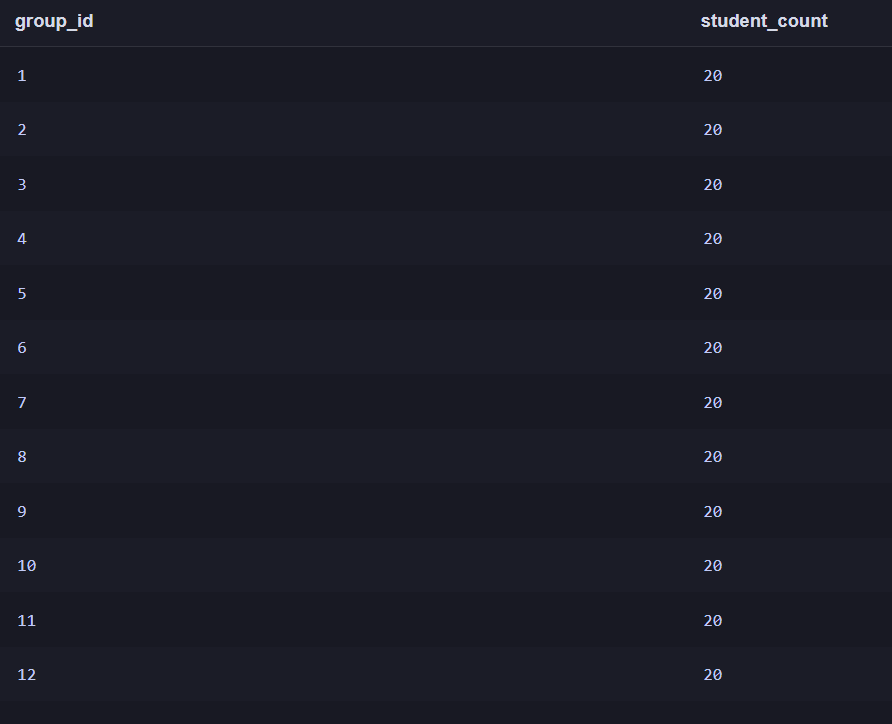

Связь students с group_id. Смотрим чтобы у группы было более 15 студентов.

Разница where и having. Having фильтрует группы, а Where отдельные строки.

## Шаг 5. Объединение связанных таблиц

### 5 Вопрос

```sql
SELECT course_id, COUNT(*) FROM enrollments JOIN results ON enrollments.id = results.enrollment_id WHERE results.score = 100 GROUP BY course_id ORDER BY COUNT(*) DESC
```
 9  
 
Связь students и courses через enrollments. Через результаты смотрим id поступления, где выводим курс. JOIN склеивает id , чтобы  по ним можно было искать студента к которому относится score.

### Студенты и названия их групп

```sql
SELECT students.full_name, groups.group_name AS group_name FROM students INNER JOIN groups ON students.group_id = groups.id LIMIT 10;
```
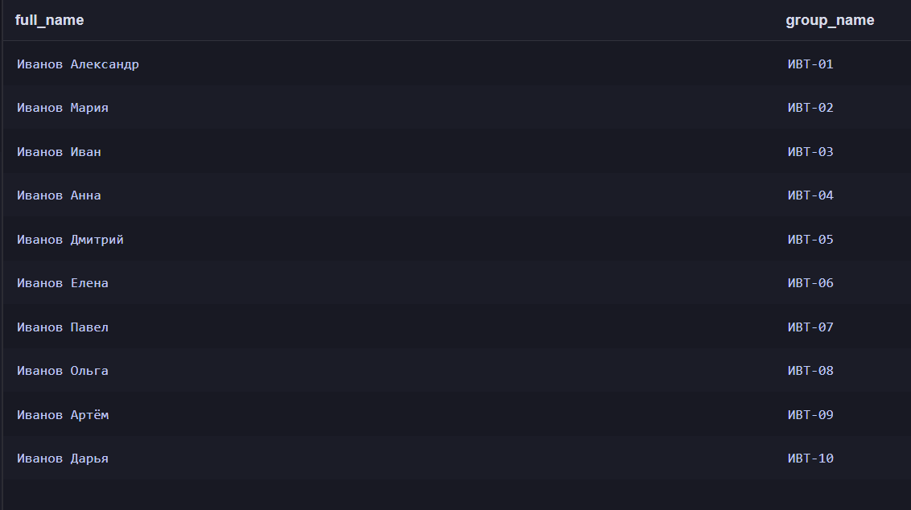

Ищет совпадение student.group_id с group.id

### Преподователи и их курсы

```sql
SELECT teachers.full_name, courses.course_name FROM teachers INNER JOIN courses ON teachers.id = courses.teacher_id;
```

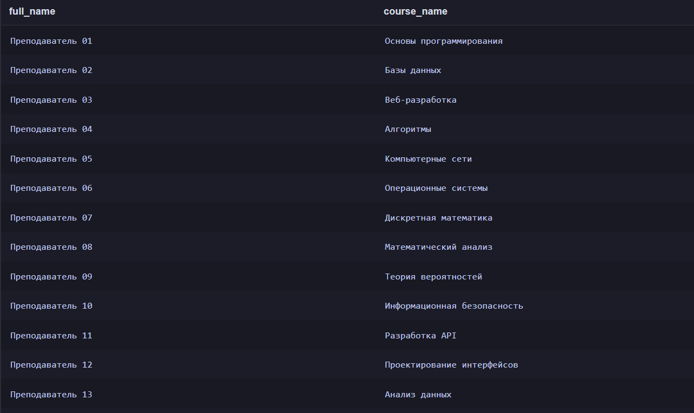


Смотрит какие преподователи ведут какие курсы

### Студенты и курсы на которые они запсианы.

```sql
SELECT students.full_name, courses.course_name FROM students LEFT JOIN enrollments ON students.id = enrollments.student_id LEFT JOIN courses ON enrollments.course_id = courses.id;
```
С помощью LEFT JOIN выводит студентов котрые никуда не записаны.

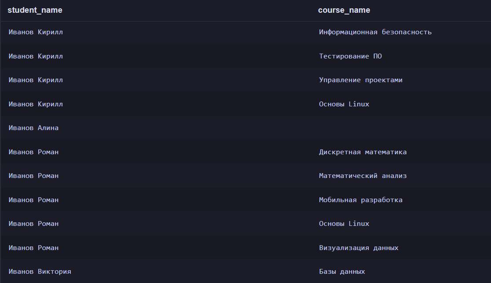

## Шаг 6. Проверка корректности данных

### Есль ли записи на курс несущетсвующих студентов

```sql
SELECT COUNT(*) AS nonexistent_enrollments FROM enrollments LEFT JOIN students ON enrollments.student_id = students.id WHERE students.id IS NULL;
```


Проверяем есть ли в enrollments id которые не совпадают не с одним из students.id

### Есть ли оценки которые меньше 0 или больше 100

```sql
SELECT COUNT(*) AS invalid_scores FROM results WHERE score < 0 OR score > 100;
```

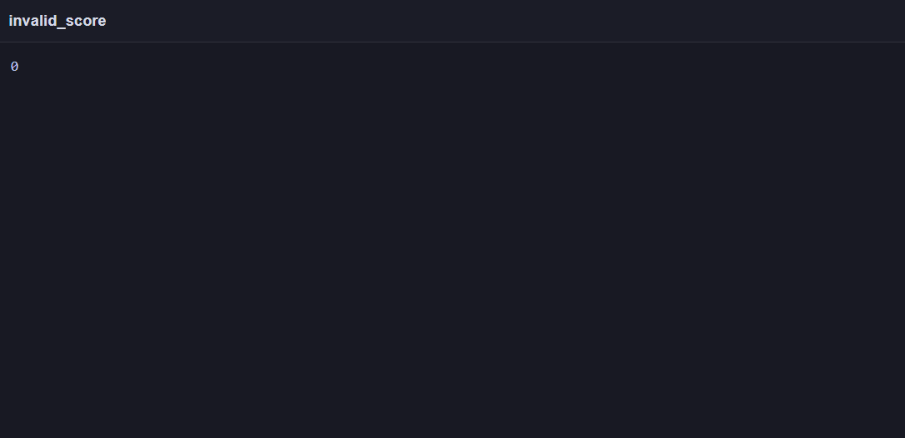

Проверяем если некорректные оценки.

Оба вопроса вернули 0.

## Шаг 7. Индивидуальное аналитическое исследование

Вариант: 6

Какие студенты ни разу не записывались на курсы? Сколько их и к каким группам они относятся?

Соединяем таблицы students и enrollments смотрим у каких студентов не будет совпадений. Затем присоединяем таблицу groups , чтобы узнать в каких группах они обучаются.

Считаем сколько всего студентов без курсов.

```sql
Select COUNT(students.id) AS students_without_courses  FROM students JOIN groups ON students.group_id = groups.id LEFT JOIN enrollments ON students.id = enrollments.student_id WHERE enrollments.id IS NULL
```
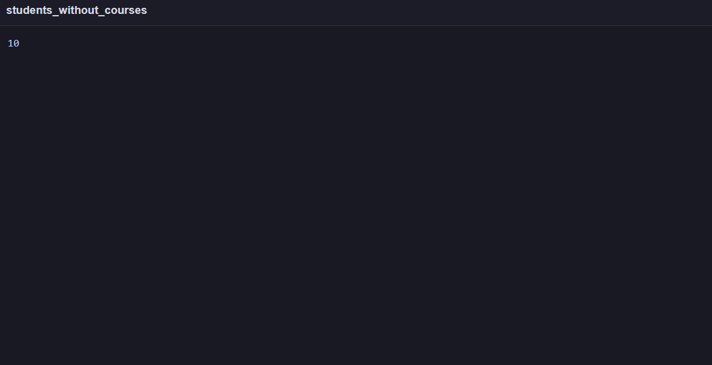
Ищем их имена и группы.

```sql
Select groups.group_name, students.full_name FROM students JOIN groups ON students.group_id = groups.id LEFT JOIN enrollments ON students.id = enrollments.student_id WHERE enrollments.id IS NULL
```
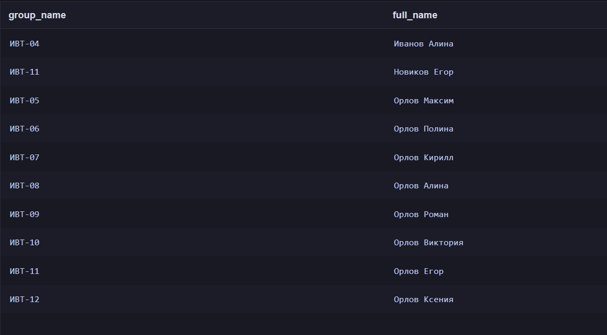

**Аналитические выводы:**

1. На курс Дискретная математика записалось больше всего человек.
2.  Курс с наибольшим количеством оценок "100" операционные системы.
3.  Есть 12 групп с количеством студентов болье 15.
4.  Есть несколько студентов не записавшихся не на один курс.
 
